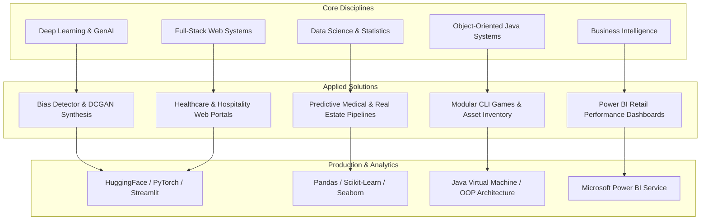

<div align="center">


[](https://www.python.org/)
[](https://www.java.com/)
[](https://pytorch.org/)
[](https://www.tensorflow.org/)
[](https://streamlit.io/)
[](https://powerbi.microsoft.com/)
[](#)

</div>

---

## 📌 Executive Summary / Overview

Welcome to the master technical repository and developer portfolio of **Jeshwanthika Pothamchetty**, Computer Applications Scholar at Alliance University, Bengaluru. This repository serves as a centralized hub organizing end-to-end engineering initiatives across four core disciplines:

1. **Artificial Intelligence & Deep Learning**: Generative Adversarial Networks (DCGAN, StyleGAN2-ADA), NLP fairness audits (Hugging Face DistilGPT-2), neural activation function mathematics, and computer vision diagnostics in healthcare.
2. **Full-Stack Web Development**: Interactive consumer and administrative portals (City Hospital, Food Cafe, Rapido Clone, Glassmorphic Student Grading Engines) built with modern semantic architectures.
3. **Data Science & Statistical Analytics**: Machine learning classification pipelines (Pima Indians Diabetes), end-to-end exploratory real estate valuation (House Price Prediction), and demographic survival analytics (Titanic EDA).
4. **Object-Oriented Software Systems**: Modular Java architectures implementing Single Responsibility Principles, LIFO deck simulators, and inventory control systems.

---

## 📖 Interactive Table of Contents

- [Executive Summary / Overview](#-executive-summary--overview)
- [Key Features & Capabilities](#-key-features--capabilities)
- [System Architecture & Developer Ecosystem](#-system-architecture--developer-ecosystem)
- [Tech Stack Breakdown](#-tech-stack-breakdown)
- [Featured Repositories & Domains](#-featured-repositories--domains)
- [Reproducible Quickstart & Setup](#-reproducible-quickstart--setup)
- [Project Directory Layout](#-project-directory-layout)
- [Author & Connect](#-author--connect)

---

## ✨ Key Features & Capabilities

- **Cross-Disciplinary AI & ML Engineering**: Hands-on generative modeling with DCGANs, latent space manipulation in StyleGAN2-ADA, and transformer bias mitigation.
- **Empirical Statistical Modeling**: Rigorous data cleaning, outlier treatment, missing value imputation, and predictive regression/classification with Scikit-Learn.
- **Business Intelligence & Dashboards**: Interactive executive Power BI reporting analyzing enterprise retail databases, transactional KPIs, and store revenues.
- **Modular Object-Oriented Design**: Strict application of OOP principles (Encapsulation, Polymorphism, Abstraction, and Separation of Concerns) in Java.
- **Production-Ready Web Applications**: Responsive web apps with modern glassmorphism UI, interactive charts, and real-time inference.

---

## 🏗️ System Architecture & Developer Ecosystem



---

## 🛠️ Tech Stack Breakdown

| Category | Technologies & Tools |
| :--- | :--- |
| **Programming Languages** | Python 3.9+, Java (JDK 17+), SQL, JavaScript, HTML5, CSS3 |
| **AI, Deep Learning & NLP** | PyTorch, TensorFlow, Keras, Hugging Face Transformers, StyleGAN2-ADA |
| **Data Science & Analytics** | Pandas, NumPy, Scikit-Learn, SciPy, Matplotlib, Seaborn |
| **Business Intelligence** | Microsoft Power BI Desktop, DAX, Power Query |
| **Web & App Frameworks** | Streamlit, Glassmorphism CSS, Flexbox/Grid UI, Responsive Web Design |
| **Dev Tools & Platforms** | Git, GitHub, Google Colab, Jupyter Notebooks, VS Code, IntelliJ IDEA |

---

## 🌟 Featured Repositories & Domains

- **[bias-detector-project](https://github.com/Jeshwanthika07/bias-detector-project)**: Streamlit NLP application detecting demographic bias in DistilGPT-2 with tone delta metrics.
- **[AI_Assignment-1](https://github.com/Jeshwanthika07/AI_Assignment-1)**: Deep Convolutional GAN (DCGAN) on Fashion-MNIST and StyleGAN2-ADA latent space synthesis.
- **[DL-Assignments](https://github.com/Jeshwanthika07/DL-Assignments)**: Deep learning architectural comparison (FNN, CNN, RNN) and mathematical activation function benchmarks.
- **[PIIMS-Indians-Diabetics](https://github.com/Jeshwanthika07/PIIMS-Indians-Diabetics)**: Predictive machine learning diagnostic classification for diabetes onset.
- **[IDS-SDS](https://github.com/Jeshwanthika07/IDS-SDS)**: Statistical real estate valuation & 52-cell end-to-end House Price exploratory pipeline.
- **[FSD_CityHospital](https://github.com/Jeshwanthika07/FSD_CityHospital)**: Responsive healthcare service discovery and clinical appointment scheduling portal.
- **[cardgame-repo](https://github.com/Jeshwanthika07/cardgame-repo)**: OOP Java card dealer simulation with LIFO Stack deck operations.

---

## 🚀 Reproducible Quickstart & Setup

### Explore and Clone Any Repository
```bash
# Clone the master portfolio showcase
git clone https://github.com/Jeshwanthika07/JeshwanthikaPothamchetty.git
cd JeshwanthikaPothamchetty

# Or clone any individual project (e.g., Bias Detector Project)
git clone https://github.com/Jeshwanthika07/bias-detector-project.git
```

---

## 📂 Project Directory Layout

```text
JeshwanthikaPothamchetty/
│
├── README.md                  # Comprehensive developer portfolio and ecosystem guide
└── LICENSE                    # Open-source MIT license
```

---

## 👩‍💻 Author & Connect

Curated with dedication by **[Jeshwanthika Pothamchetty](https://github.com/Jeshwanthika07)**  
*Computer Applications Scholar | Alliance University, Bengaluru*  
- **GitHub**: [@Jeshwanthika07](https://github.com/Jeshwanthika07)  
- **Email**: [pjeshwanthika9@gmail.com](mailto:pjeshwanthika9@gmail.com)

<div align="center">


</div>
